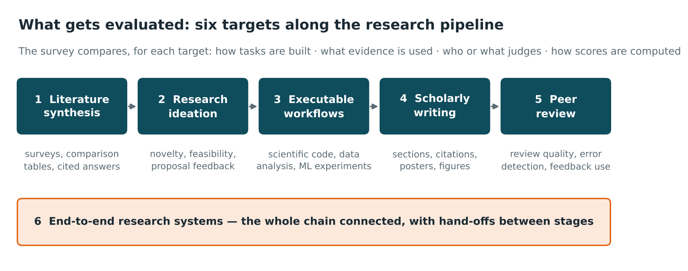
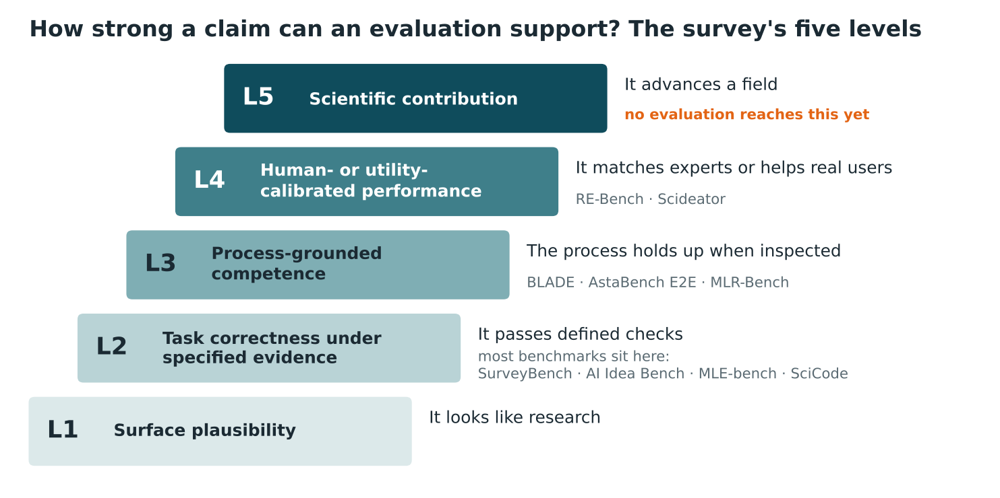
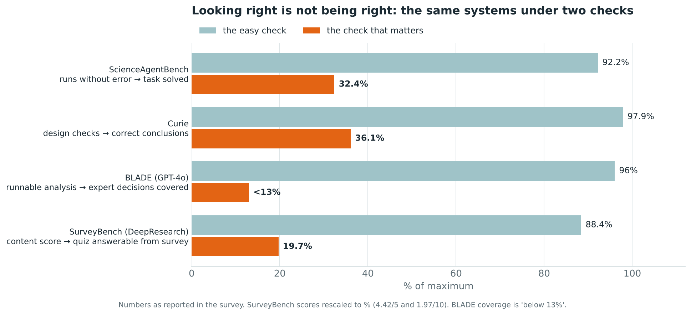

# Short story — How Is Automated Research Evaluated?

CMPE 297 (Special Topics), Fall 2026 · Gowri Preetham Gunisetty · individual assignment

**Paper:** Zhang, Zhou, Huang, Chen, Yao, Chao, Vong, Wong — *How Is Automated Research Evaluated? A Survey of Benchmarks and Evaluation Practices*, University of Macau NLP²CT Lab, [arXiv:2610.11877](https://arxiv.org/abs/2610.11877) (October 2026).

**In one line:** AI systems can now draft surveys, propose ideas, run experiments, write papers and review them — this survey asks what the benchmarks used to test them actually prove.

## Deliverables

| Deliverable | Link |
|---|---|
| Medium article | _add Medium link after publishing_ |
| Slides on SlideShare | _add SlideShare link after uploading_ |
| Video presentation (YouTube) | _add YouTube link after uploading_ |
| Article source | [`article/medium_article.md`](article/medium_article.md) |
| Slide deck | [`slides/automated_research_evaluation.pptx`](slides/automated_research_evaluation.pptx) · [PDF](slides/automated_research_evaluation.pdf) |
| Video script (also in the slides' speaker notes) | [`video/video_script.md`](video/video_script.md) |
| Video file | `video/` — _add the recording_ |
| Figures (my own) and the code that draws them | [`figures/`](figures) · [`build/make_figures.py`](build/make_figures.py) |

## What the article and talk cover

1. **The taxonomy — six evaluation targets:** literature synthesis, research ideation, executable workflows, scholarly writing, automatic peer review, and end-to-end research systems.
2. **Key benchmarks per target** and the catch the survey finds in each: SurveyBench, AI Idea Bench, SciCode, MLE-bench, RE-Bench, BLADE, GREP, FLAWS, SPOT, AstaBench, MLR-Bench, ResearchGym.
3. **Five claim-strength levels (L1–L5):** from "looks like research" to "scientific contribution" — most benchmarks sit at L2, none reach L5.
4. **Three cross-cutting lessons:** check the process as well as the output; a judge is only calibrated for the property it was validated on; budgets and best-of-n selection are part of the result.
5. **Reporting recommendations**, condensed into a five-line label.
6. **Two related surveys** for context: Yehudai et al., *Survey on Evaluation of LLM-based Agents* ([arXiv:2503.16416](https://arxiv.org/abs/2503.16416)); Wang et al., *Log Analysis for LLM-Based Agents* ([arXiv:2611.23281](https://arxiv.org/abs/2611.23281)).
7. **My two cents**, drawing on the autoresearch harness and self-improvement study I built in this course.





## Rebuild

```bash
pip install matplotlib python-pptx && npm install pptxgenjs
python build/make_figures.py      # figures/*.png
node build/make_deck.js           # slides/*.pptx  (edit the skill path at the top of the file if needed)
```

## Notes

- The article is written from scratch; all figures are my own drawings. Numbers are as reported in the survey.
- AI assistance was used for drafting and for building the figures and slides.
