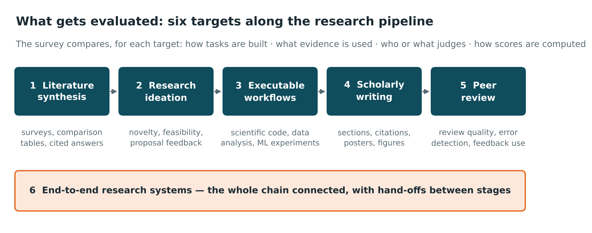
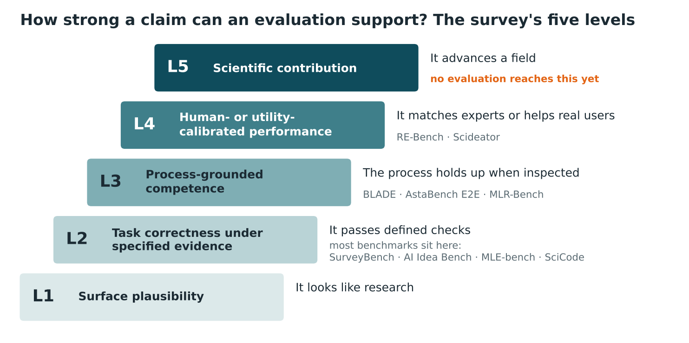
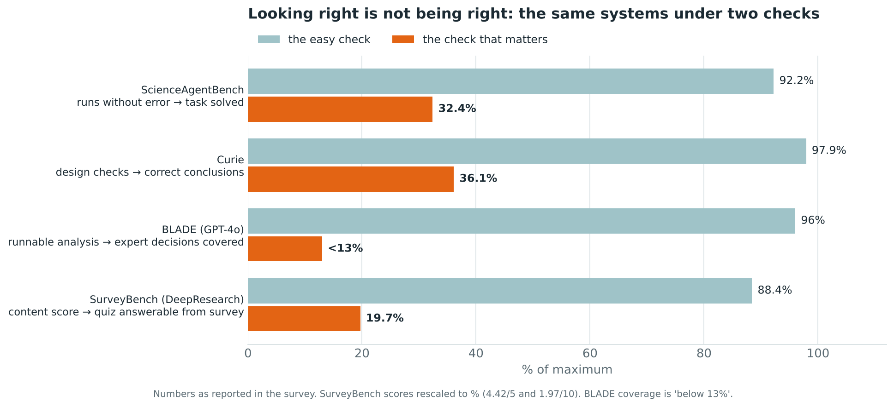
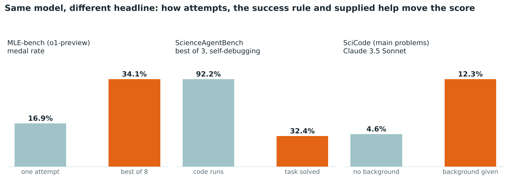
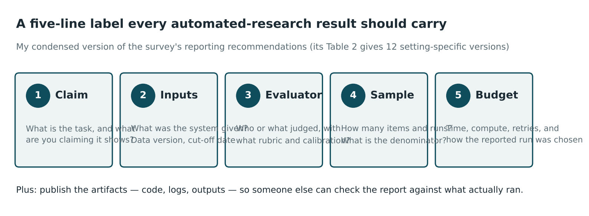

# AI Can Now Write Research Papers. How Do We Know If the Research Is Any Good?

*A plain-English tour of the October 2026 survey "How Is Automated Research Evaluated?" — its taxonomy, the benchmarks behind the headlines, and what I learned when I tried to grade an AI researcher myself.*

---

## The 92% that was really 32%

Here is a number that sounds like a solved problem. On ScienceAgentBench, a benchmark of 102 data-driven science tasks, a Claude-based agent with self-debugging produced code that **ran without errors 92.2% of the time**.

Here is the number next to it: the code actually **solved the task 32.4% of the time**.

Both numbers come from the same runs. One measures whether the work *looks* finished. The other measures whether it *is* right. Most of the confusion about "AI scientists" lives in the gap between those two.

That gap is the subject of a survey I spent this week with: **"How Is Automated Research Evaluated? A Survey of Benchmarks and Evaluation Practices"** by Liulei Zhang, Dejing Zhou and colleagues at the University of Macau's NLP²CT Lab ([arXiv:2610.11877](https://arxiv.org/abs/2610.11877)). It does not ask "how good are AI research agents?" It asks the question underneath: **what do the tests we use on them actually prove?**

This article is my summary of it, with the math left out and my own opinions clearly marked.

## What counts as "automated research"

The survey looks at systems that take over parts of a researcher's job: finding and summarising papers, proposing ideas, running experiments, writing them up, and reviewing other people's manuscripts. It covers work where the tasks and scoring can be inspected, searched across Google Scholar, arXiv, Semantic Scholar and the ACL Anthology up to May 2026.

It deliberately leaves out plain retrieval, single-paper question answering, generic coding benchmarks and robot wet labs. Most of what it covers is AI/ML research evaluated by AI/ML researchers — a limitation the authors state themselves.

## The taxonomy: six things you can evaluate

The survey's main organising idea is simple. Follow a research project from start to finish and you get five stages, plus the case where one system does all of them.

For each target, the authors compare four design choices: how the tasks are built, what evidence the system is given, who or what does the judging, and how the score is computed. Here is the short version of each.

### 1. Literature synthesis

*Can it write a survey, a comparison table, or a cited answer?*

Benchmarks here include **AutoSurvey**, **SurGE** (205 human-written surveys with a shared pool of papers to retrieve from), **ArxivDIGESTables** for comparison tables, **OpenScholar** (cited answers judged by 16 experts) and **SurveyBench**.

SurveyBench is the one that stuck with me. Instead of asking a judge "is this survey good?", it asks whether a reader could answer quiz questions from it. A deep-research system scored 4.42 out of 5 on content quality — and about 1.97 out of 10 on topic-specific questions. Fluent, well-organised, and not much use if you needed a specific answer.

The survey also points out a quieter problem: metrics with the same name are not the same metric. "Citation recall" in one benchmark only counts sentences that already carry a citation; in another it is measured against a human reference list. You cannot put those two numbers in one table.

### 2. Research ideation

*Are its ideas new, and would they work?*

The best-known study is by Si and colleagues: over a hundred NLP researchers, blinded, rating ideas written by humans and by an LLM. The AI ideas were rated **more novel**. Feasibility showed no significant difference.

That result gets quoted a lot. The survey's point is about what it does not show: nobody ran the ideas. Benchmarks such as **AI Idea Bench** (3,495 target papers) estimate feasibility with proxies like later citation impact, which says nothing about whether the method's steps fit together. And in MLRC-Bench, novelty ratings had essentially zero correlation (−0.06) with how well the methods actually performed. The authors are careful here — that does not prove the novelty ratings are wrong — but it does mean "judged novel" and "works" are separate facts.

### 3. Executable workflows and scientific coding

*Can it run the experiment?*

This is the most mature area, because code can be executed and checked. **SciCode** has 65 research problems split into 288 sub-problems; a strong model solved 26% of the sub-problems but only 4.6% of the full problems. **MLE-bench** uses 75 Kaggle competitions with medal thresholds. **RE-Bench** compares agents with 61 human experts under a time limit. **BLADE** checks something subtler: not whether the analysis runs, but whether the agent made the analysis *decisions* an expert would — which variables, which transformations, which model.

### 4. Scholarly writing

*Are the sections faithful, and are the citations real?*

Related-work generators, citation checkers, poster and figure generators. The recurring finding is that word-overlap metrics agree poorly with human judgments of factual accuracy. In one expert study (GREP), a current model passed a section-level faithfulness check only 20% of the time. Citation auditors also behave differently on different collections: one tool's precision dropped from .947 to .749 between datasets while its recall barely moved.

### 5. Automatic peer review

*Can it review a paper — and does the review help anyone?*

There are three different questions hiding here, and the survey separates them: is the generated review good (ReviewEval), can the system find real errors (FLAWS, with 713 paper–error pairs; SPOT, with 91 errors the authors themselves acknowledged), and does AI feedback change what human reviewers do (a randomized study at ICLR covering more than 22,000 reviews).

One detail from SPOT is worth remembering. Experts checking the benchmark found a genuine error that was *not* in the answer key. Under the benchmark's rules, a system that found it would have been marked wrong.

### 6. End-to-end research systems

*Can it do the whole thing?*

**AI Scientist**, **DeepScientist**, and the suites built to test them: **AstaBench**, **MLR-Bench**, **ResearchGym**, **AIRS-Bench**, **FIRE-Bench**.

Two results from this section should be on a poster. In AstaBench's end-to-end benchmark, **16% of rubric items looked satisfied in the written report but were contradicted by the code and artifacts**. In MLR-Bench, **eight out of ten** coding-agent runs contained placeholder or synthetic results that were never verified. If you only read the paper the agent wrote, you would not know.

## How strong is the claim? Five levels

The second idea I found useful is a ladder for what an evaluation can support.

- **L1 — it looks like research.** Style and form.
- **L2 — it passes defined checks.** Correct under the inputs and tests the benchmark specifies.
- **L3 — the process holds up.** Someone inspected how the result was produced, not just the result.
- **L4 — it matches experts or helps users.** Calibrated against a defined group of people or a real outcome.
- **L5 — it is a scientific contribution.**

When the authors place representative benchmarks on this ladder, most land on L2. A few reach L3 (BLADE, AstaBench's end-to-end track, MLR-Bench) or L4 (RE-Bench, Scideator). **Nothing reaches L5.** The authors are clear that these levels are a reading aid, not a validated scale — but as a way to deflate a headline, they work.

## Three lessons that cut across everything

### Lesson 1: Check the process, not only the output

The pattern from the opening repeats across the field. An experimentation agent passed 97.9% of design checks and got 36.1% of its conclusions right. On BLADE, 96% of analyses ran, while coverage of the expert decisions stayed under 13%. Output checks, process checks and human studies each catch things the others miss, so the survey's advice is to use them together and report them separately.

### Lesson 2: A judge is only calibrated for the thing you calibrated it on

LLM judges are everywhere in these benchmarks, and they have known habits — favouring longer answers, answers in a certain position, and possibly their own outputs. The survey's sharper point is that validation does not transfer. If experts confirmed that your judge ranks *structure* well, that tells you nothing about whether it can verify *citations*. One example: a claim-verification system for peer reviews reached a best four-class accuracy of only .287 on real review claims.

### Lesson 3: Budgets and "best of n" are part of the result

On MLE-bench the same model earned a medal in 16.9% of single attempts and 34.1% when allowed eight. Neither number is wrong. They answer different questions, and a paper that reports one without saying which has not told you much. The same goes for time limits, hardware, and whether the system was handed a starting solution. RE-Bench's human baseline at 32 hours, for instance, comes from picking among four independent attempts.

## What the authors recommend

The survey ends with reporting recommendations, broken into twelve setting-specific versions in its appendix. I condensed them into a label I would like to see on every result:

## Where this fits with other recent surveys

Two other surveys make a useful frame around this one.

**"Survey on Evaluation of LLM-based Agents"** (Yehudai et al., ACL Findings; [arXiv:2503.16416](https://arxiv.org/abs/2503.16416)) covers agent evaluation in general — core capabilities like planning and tool use, application benchmarks for web and software agents, generalist agents, and developer tooling. Automated research is one demanding application inside that map, and the Macau survey is the deep dive on it.

**"Log Analysis for LLM-Based Agents: A Lifecycle-Oriented Survey"** (Wang et al., October 2026; [arXiv:2611.23281](https://arxiv.org/abs/2611.23281)) reviews 90 studies on agent logging, log structuring and log mining. Its warning lines up neatly with Lesson 1: having detailed logs does not mean you have enough evidence. Stored traces are raw material; a process check still has to be designed.

## My two cents

**It matched my own experience uncomfortably well.** For this course I built a small "autoresearch" harness — an agent proposes ML experiments, and a referee I wrote decides which ones count. Without having read this survey, I ended up needing exactly the controls it describes: labels the agent cannot see, a fixed experiment budget, and a test set that is opened once. In a second project comparing self-improvement methods, one method picked a rule that scored well on the training cases and then crashed on unseen ones. An output-only check on the training data would have called that run a success.

**The ladder is the part I will reuse.** "Which level is this claim?" is a question you can ask of any result in thirty seconds. It would have saved me from over-reading a few of my own.

**What I think is missing.** The survey compares what papers *report*; the authors did not re-run anything, and they say so. I would have liked one or two benchmarks audited end to end. I also think cost deserves more room. If a system needs tens of thousands of GPU hours to produce one accepted result, "it works" and "it is worth it" are very different statements.

**The uncomfortable conclusion.** Right now, the honest summary of most "AI scientist" results is: *correct on defined checks, under a stated budget, on AI/ML tasks.* That is real progress. It is not yet "does science", and the tests that could tell us the difference have mostly not been built.

## If you only remember three things

1. Ask what was checked: the output, the process, or the effect on people.
2. Ask who judged, and what that judge was validated for.
3. Ask how many attempts, how much compute, and how the reported run was chosen.

---

### References

- Zhang, L., Zhou, D., Huang, C., Chen, G., Yao, Y., Chao, L. S., Vong, C. M., Wong, D. F. *How Is Automated Research Evaluated? A Survey of Benchmarks and Evaluation Practices.* arXiv:2610.11877, 2026.
- Yehudai, A. et al. *Survey on Evaluation of LLM-based Agents.* ACL Findings; arXiv:2503.16416.
- Wang, C. et al. *Log Analysis for LLM-Based Agents: A Lifecycle-Oriented Survey.* arXiv:2611.23281, 2026.

*All figures are my own drawings. Numbers are as reported in the survey; any errors in transcription are mine. Slides, video and source for the figures: [github.com/gowripreetham/SJSU_Special_topics_Short_Story](https://github.com/gowripreetham/SJSU_Special_topics_Short_Story).*
